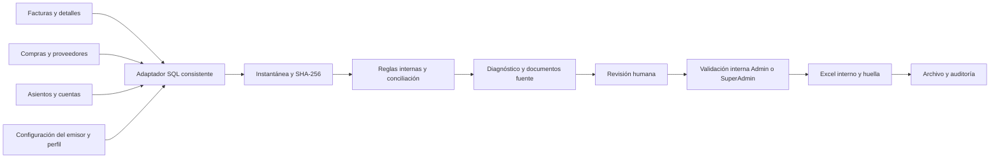
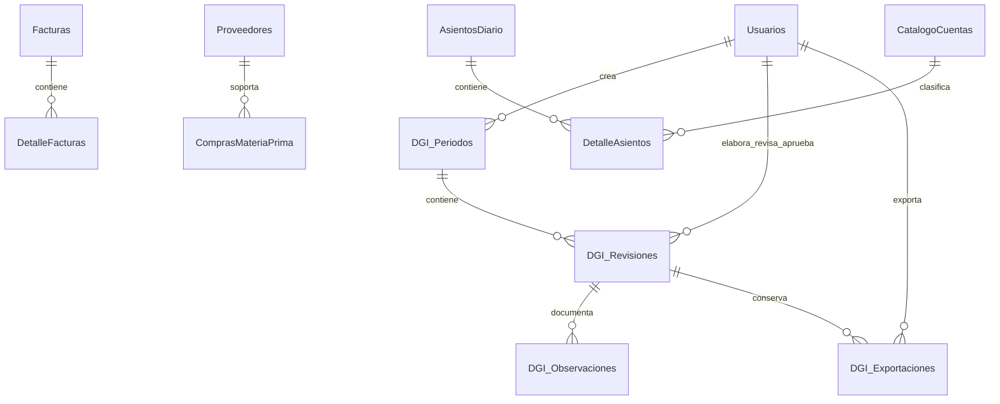
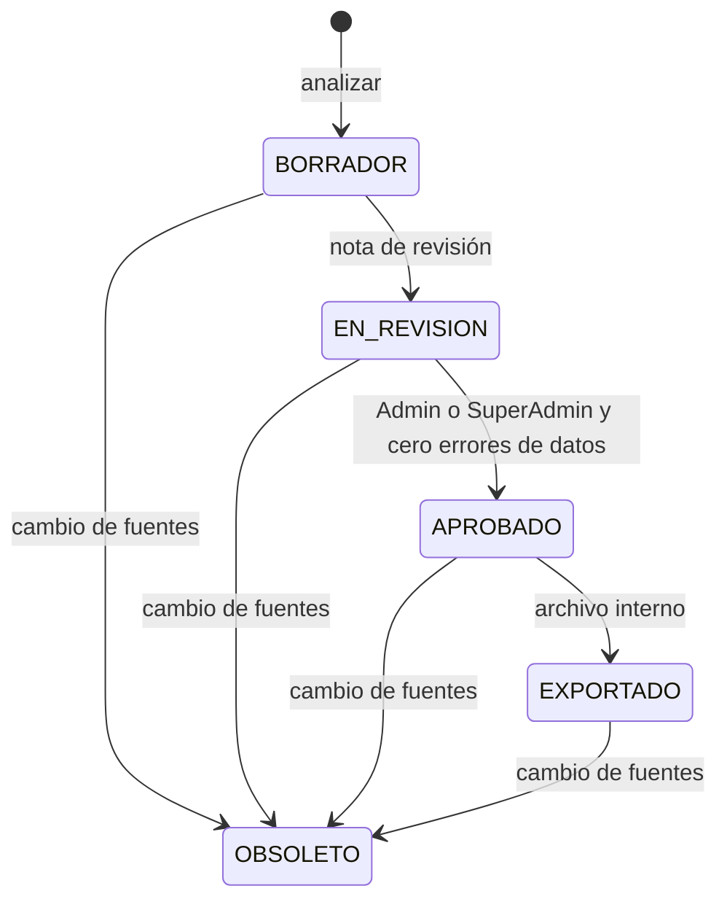
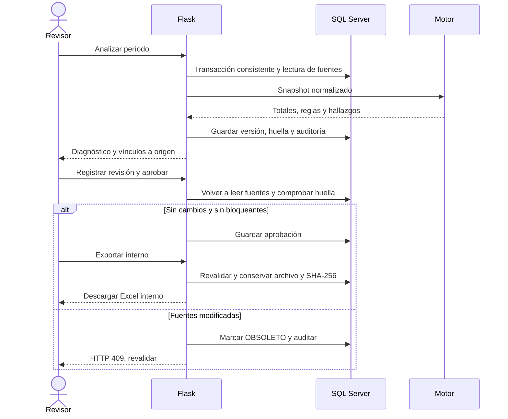

# Arquitectura, datos y decisiones

Versión funcional 1.1. El detalle del reloj comercial, normalización histórica
con evidencia y diagnóstico sin aprobación está en [REVISION_FUNCIONAL.md](REVISION_FUNCIONAL.md).

## Componentes

`app/admin/routes_dgi.py` añade rutas a `admin_bp`. Usa los mismos modelos de
usuario, plantilla base, menú y CSRF que el resto del administrador.
`dgi_repository.py` adapta SQL Server, administra transacciones y el flujo.
`dgi_engine.py` contiene reglas internas puras y deterministas con metadatos
versionados. `dgi_excel.py` produce XLSX OOXML con la biblioteca estándar de
Python, para que el servidor Flask no dependa de Node, Excel instalado ni un
proceso externo. No se añaden dependencias de producción.

El perfil comparte los datos del emisor existentes. Solo se agregan claves
`dgi_obligaciones`, `dgi_responsable`, `dgi_vigente_desde`, `dgi_vigente_hasta`.
La instalación actual es de una empresa; no se crea un selector multiempresa
que sugiera aislamiento no implementado.

## Esquema lógico y físico

Las referencias comerciales en la instantánea son IDs, números y datos monetarios
de origen, no nuevas ventas ni compras. Se conserva el contenido normalizado
necesario para reproducir la revisión. No hay FK desde el JSON a las fuentes;
la huella detecta cambios y las pantallas muestran los registros actuales.

| Tabla | Campos principales / tipos SQL Server | Integridad |
|---|---|---|
| DGI_Periodos | ID int identity; Desde/Hasta date; Estado varchar(12); CreadoPor int; CreadoEn datetime2 UTC | Intervalo válido; intervalo único; FK Usuarios |
| DGI_Revisiones | ID/PeriodoID int; Obligacion nvarchar(200); Version int; Motor varchar(30); Huella char(64); SnapshotJSON/ResultadoJSON nvarchar(max); Estado varchar(15); actores int; fechas datetime2 UTC; NotaRevision nvarchar(1000) | FK período/usuarios; versión única por período y obligación; CHECK de estados |
| DGI_Observaciones | ID/RevisionID/UsuarioID int; Hallazgo char(24); Comentario nvarchar(1000); Fecha datetime2 UTC | FK revisión/usuario; el servidor valida pertenencia del hallazgo; inserción de seguimiento |
| DGI_Exportaciones | ID/RevisionID/UsuarioID int; Nombre nvarchar(150); SHA256 char(64); Archivo varbinary(max); Fecha datetime2 UTC | Copia exacta del archivo generado; FK revisión/usuario; SHA-256 verificado al descargar |
| BitacoraFiscal existente | Fecha UTC explícita para acciones DGI; actor, acción, entidad, ID y Detalle JSON | Se reutiliza el trigger existente de no edición/borrado; no guarda RUC ni comentarios sensibles |

Esquema ejecutable: `scripts/migrate_dgi.py`. No se modifica el script destructivo
`database/esquema.sql`. Una instalación limpia debe completar las migraciones
previas y después ésta. La reversión solo permite tablas y perfil DGI vacíos.
No se elimina historial para simular una reversión exitosa.

## Consistencia y reproducción

Las fuentes se consultan dentro de la misma transacción SERIALIZABLE. Incluye
rangos de emisión/anulación, compras, asientos, detalles y perfil. El bloqueo
tiene límite de espera de 15 segundos; esta decisión prioriza consistencia sobre
concurrencia para el MVP y requiere medir carga antes de producción.

El JSON canónico usa claves ordenadas, Decimal serializado como texto y fechas
ISO. La huella incluye el motor, el perfil, la obligación y las fuentes ordenadas
por ID. Se omiten QR y datos de clientes; se conserva la huella del documento
fiscal original para detectar cualquier cambio en él.

Antes de revisar, aprobar, exportar y descargar se consultan de nuevo las fuentes.
Un cambio marca `OBSOLETO`, conserva actor/fecha de la aprobación histórica y
deniega el uso actual. El evento de caducidad se confirma incluso si la operación
termina en HTTP 409. Revalidar crea otra versión y conserva las anteriores.
Si no hay cambios, el diagnóstico devuelve la misma revisión. Repetir una
exportación devuelve los mismos bytes y la misma huella.

La suma monetaria usa Decimal sin tasas añadidas. No se redondea un saldo a cero
para ocultar diferencias. La interfaz y Excel presentan dos decimales monetarios;
los valores originales y el motor conservan la precisión registrada. La clase
Ingreso incluye ajustes/devoluciones catalogados como tales. Un ingreso de otro
origen puede explicar una diferencia: el motor pide revisión, no dicta infracción.

## Estados y seguridad

Admin y SuperAdmin pueden configurar, elaborar, revisar, validar internamente,
exportar y cerrar/reabrir preparación. No se
introducen roles ficticios de contador/auditor. La aplicación permite que una
misma persona con rol administrativo elabore y valide, dejando ambas identidades y fechas;
una segregación de personas estricta requeriría una política adicional.

Todas las mutaciones son POST con CSRF. SQL usa parámetros; los nombres de tipos
de documentos se eligen de un catálogo fijo. Descargas requieren sesión y
aprobación vigente. El XLSX guarda las entradas como texto literal inlineStr, sin
fórmulas, macros, enlaces externos ni contenido ejecutable. No existe importación
de archivos en este MVP, por lo que no se habilita una superficie de carga nueva.

## Rutas

| Método / ruta bajo `/admin/dgi` | Uso | Rol |
|---|---|---|
| GET `/` | Panel, perfil, períodos, historial y actividad | Admin/SuperAdmin |
| POST `/perfil` | Guardar perfil compartido y vigencia | Admin/SuperAdmin |
| POST `/periodos` | Crear/seleccionar mes | Admin/SuperAdmin |
| POST `/periodos/<id>/estado` | Cerrar/reabrir preparación | Admin/SuperAdmin |
| POST `/revisiones` | Analizar/revalidar período | Admin/SuperAdmin |
| GET `/revisiones/<id>` | Snapshot, diagnóstico, seguimiento e historial | Admin/SuperAdmin |
| POST `/revisiones/<id>/revisar` | Registrar revisión humana | Admin/SuperAdmin |
| POST `/revisiones/<id>/observaciones` | Comentar hallazgo de esa revisión | Admin/SuperAdmin |
| POST `/revisiones/<id>/aprobar` | Validar sin errores de datos ni cambios | Admin/SuperAdmin |
| POST `/revisiones/<id>/diagnostico.xlsx` | Diagnóstico sin aprobación, incluso con errores | Admin/SuperAdmin |
| POST `/revisiones/<id>/exportar` | Generar/reutilizar informe validado | Admin/SuperAdmin |
| GET `/exportaciones/<id>` | Descargar bytes verificados | Admin/SuperAdmin |
| POST `/revisiones/<id>/exportar-oficial` | Siempre HTTP 409, pendiente normativo | SuperAdmin |
| GET `/fuentes/<tipo>/<id>` | Consultar registro actual y enlace al propietario | Admin/SuperAdmin |

## Secuencia de aprobación y exportación

